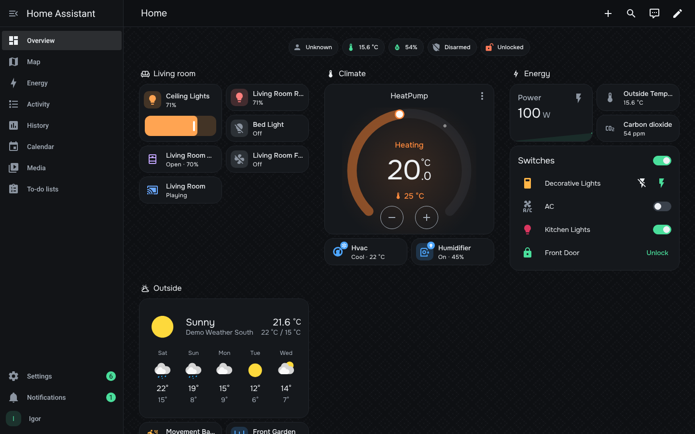
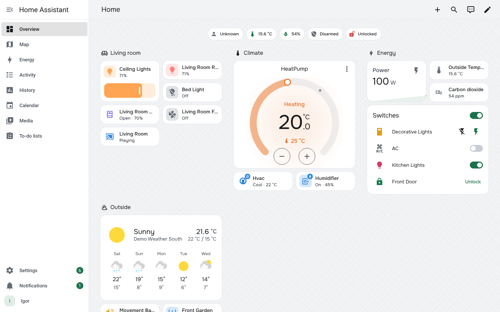
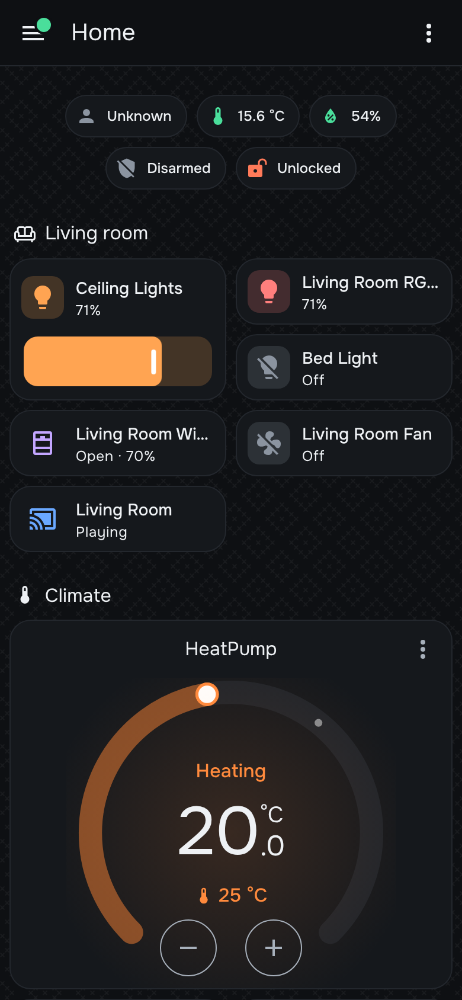
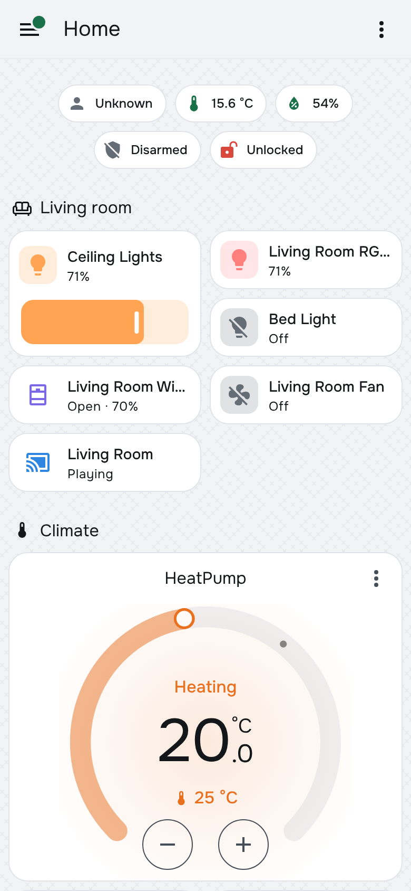
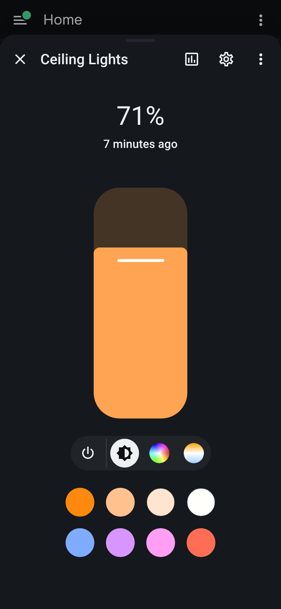
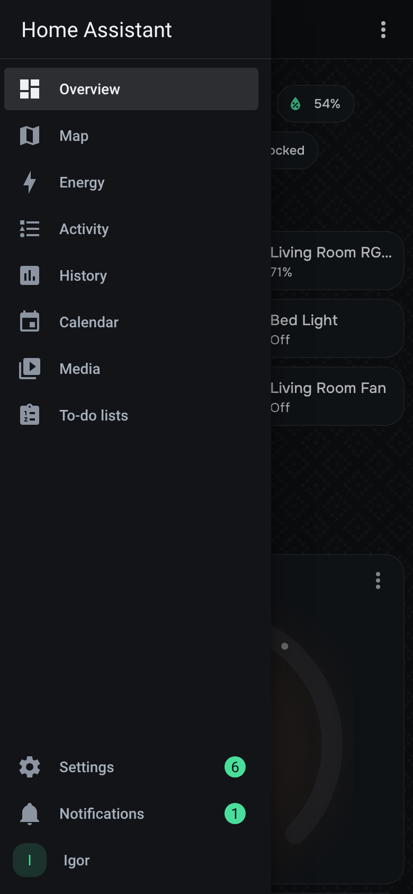
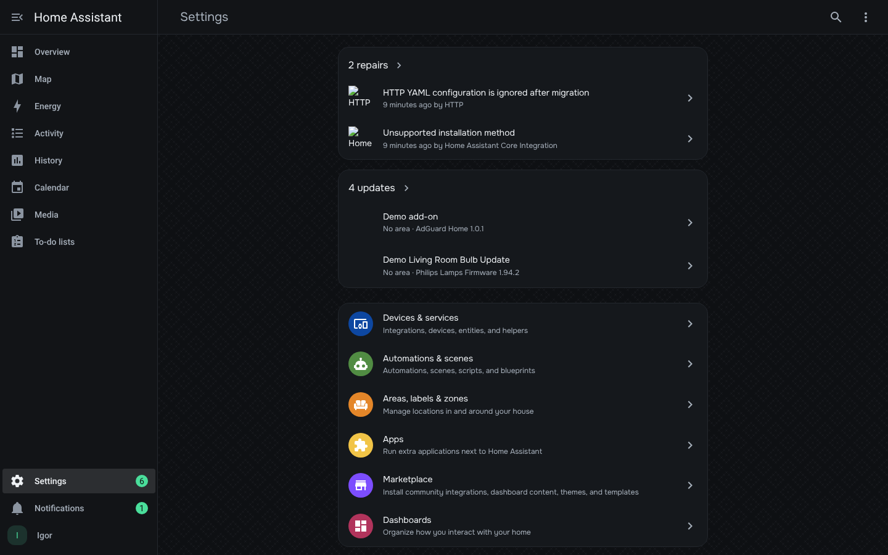
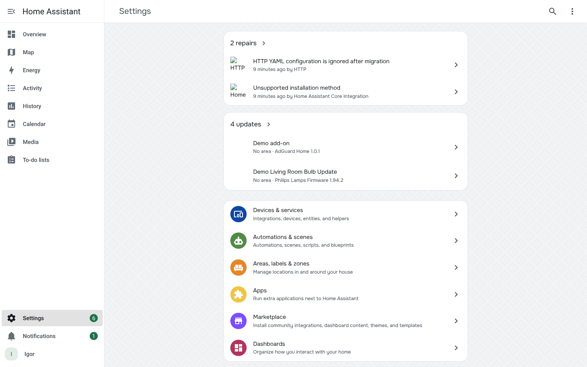
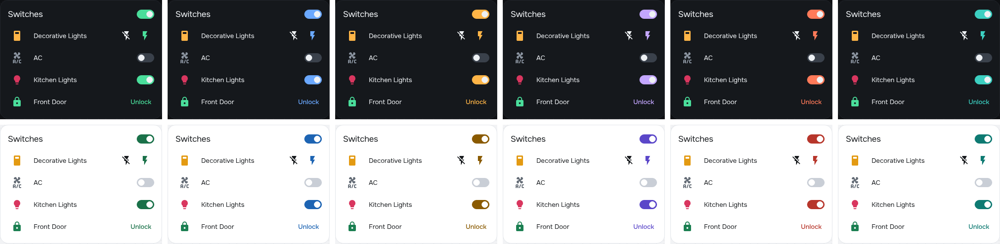

# Osnova

[](https://hacs.xyz/docs/faq/custom_repositories)
[](https://github.com/RobinCK/osnova/releases/latest)

A Home Assistant theme for the whole interface: dashboards, the sidebar, dialogs and settings. Graphite surfaces, a single accent colour, Onest and JetBrains Mono, and a barely visible Ukrainian cross-stitch ornament behind every page. Light, dark and auto modes, six colourways.

| Dashboard — dark                                   | Dashboard — light                                    |
| -------------------------------------------------- | ---------------------------------------------------- |
|  |  |

| Phone — dark                               | Phone — light                                | More info                                            | Sidebar                                   |
| ------------------------------------------ | -------------------------------------------- | ---------------------------------------------------- | ----------------------------------------- |
|  |  |  |  |

| Settings — dark                                  | Settings — light                                   |
| ------------------------------------------------ | -------------------------------------------------- |
|  |  |

The screenshots use the Home Assistant demo integration.

## Features

- Themes the whole UI, not only dashboards: page background, sidebar, top bars, dialogs, forms, data tables and switches, including the `--ha-color-*` design tokens of recent Home Assistant versions.
- Light and dark modes in one theme, so **Auto** follows the device.
- Six colourways that change only the accent colour.
- A cross-stitch ornament (хрестик) at 5 % opacity on the page background of every panel. Cards and dialogs stay solid.
- Flat cards with a 1 px edge and 18 px corners, rounded-square tile icons and compact 40 × 24 switches.
- State and energy colours from the same palette: lights and other active states in amber, heating in orange, cooling in blue, gas in teal, alerts in coral.
- Plain hex colours, so charts, maps and history graphs use them too.

## Colourways

| Theme             | Accent              | Dark      | Light     |
| ----------------- | ------------------- | --------- | --------- |
| `Osnova`          | Khvoia — pine       | `#4ADE9B` | `#1A7149` |
| `Osnova Nebo`     | Nebo — sky          | `#6AA8FF` | `#1D64B3` |
| `Osnova Burshtyn` | Burshtyn — amber    | `#FFB547` | `#8A5A00` |
| `Osnova Buzok`    | Buzok — lilac       | `#C3A6FF` | `#5B47C9` |
| `Osnova Koral`    | Koral — coral       | `#FF7A59` | `#B7362B` |
| `Osnova Biriuza`  | Biriuza — turquoise | `#3CCFC1` | `#0E7A72` |



## Installation

### HACS (recommended)

[](https://my.home-assistant.io/redirect/hacs_repository/?owner=RobinCK&repository=osnova&category=theme)

Or add it manually:

1. Open **HACS** in Home Assistant.
2. Open the menu in the top right corner and choose **Custom repositories**.
3. Add `https://github.com/RobinCK/osnova` with the type **Theme**.
4. Search for **Osnova** and click **Download**.

### Manual

Copy [`themes/osnova.yaml`](themes/osnova.yaml) to `<config>/themes/osnova.yaml`.

### Enable themes

If themes are not enabled yet, add this to `configuration.yaml` and restart Home Assistant:

```yaml
frontend:
  themes: !include_dir_merge_named themes
```

After an update, run the `frontend.reload_themes` action (**Developer tools → Actions**) instead of restarting.

## Usage

Open your **Profile**, pick **Osnova** or another colourway under **Theme** and choose **Auto**, **Light** or **Dark**.

To make it the default for every user and device, run `frontend.set_theme` once for each mode:

```yaml
action: frontend.set_theme
data:
  name: Osnova
  mode: light
```

```yaml
action: frontend.set_theme
data:
  name: Osnova
  mode: dark
```

### Fonts

Osnova uses Onest for text and JetBrains Mono for code, with Roboto as the fallback. A theme cannot load fonts by itself, so add them as a dashboard resource:

1. Go to **Settings → Dashboards → ⋮ → Resources** and add a resource:
   - URL: `https://fonts.googleapis.com/css2?family=Onest:wght@400;500;600;700&family=JetBrains+Mono:wght@400;500;600&display=swap`
   - Type: **Stylesheet**
2. Reload the browser page.

Resources load together with dashboards. If a settings page is the first page you open after a reload, it shows Roboto until a dashboard has been opened.

### Background ornament

The ornament is a 40 × 40 px cross-stitch tile drawn in the text colour of the current mode at 5 % opacity. It is set with `ha-panel-background`, which covers every panel, and with `lovelace-background` for dashboards on older Home Assistant versions. A background set in a dashboard view's settings replaces it on that view.

## Requirements

Tested with Home Assistant 2026.11. Older versions ignore the variables they do not know.

## Releases

Releases are published by hand: **Actions → Release → Run workflow** with the version, for example `1.0.0`. The HACS validation workflow also runs only by hand.

## Other Home Assistant projects

- [Blackout](https://github.com/RobinCK/blackout) — integration for planned and emergency power outages in Ukraine: schedules for 21 regions, the Ukrenergo grid state, outage history and dashboard cards.
- [Sirio Pump Inverter (WiNET)](https://github.com/RobinCK/ha-sirio-winet) — local integration for Italtecnica Sirio pump inverters with the WiNET Wi-Fi module, with a pressure gauge card.
- [Klimo](https://github.com/RobinCK/klimo) — add-on for room-by-room heating and cooling: heat pumps, boilers, air conditioners, heaters and circulation pumps.
- [Zroshua](https://github.com/RobinCK/zroshua) — add-on for smart irrigation: zones, schedules, weather, rain and soil sensors and a live site map.
- [Metron](https://github.com/RobinCK/lovelace-metron) — Lovelace cards for energy, solar, battery, gas and money: live flows, statistics, forecasts and bills.
- [Varta](https://github.com/RobinCK/lovelace-varta) — Lovelace cards that keep watch over the house: offline devices grouped by hub or integration, and batteries with a replacement forecast.
- [Deye Inverter Card](https://github.com/RobinCK/lovelace-deye-inverter-card) — Lovelace card with the state and live values of Deye/Sunsynk hybrid inverters.
- [Phase Pair Card](https://github.com/RobinCK/lovelace-phase-pair-card) — Lovelace card for three-phase homes: voltage and power before and after the voltage stabilizers, phase balance.
- [Deck Card](https://github.com/RobinCK/lovelace-deck-card) — adaptive container card that groups cards into segments: pills on wide screens, swipe on phones.
- [Solax2HA](https://github.com/RobinCK/solax2ha) — service that sends Solax inverter data to Home Assistant sensors.

## License

[MIT](LICENSE)
